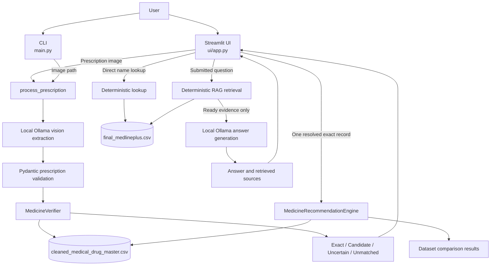

# AI Prescription Analysis Assistant

An academic Python application that helps users read medicine information from
prescription images. It extracts visible prescription text with a local
vision-language model, validates the structure, compares extracted medicines
with a local drug-master dataset, and presents dataset-grounded medical
information in a Streamlit interface.

The project is intended to make prescription information easier to review. It
does not prescribe medicine, replace a clinician, or establish that two
products are clinically interchangeable.

## Implemented features

- Local prescription-image extraction through Ollama using `qwen2.5vl:3b`.
- Structured prescription and medicine validation with Pydantic.
- Medicine verification with four distinct outcomes: `exact_match`,
  `candidate_match`, `uncertain`, and `unmatched`.
- Explicit strength, dosage-form, and release-characteristic checks where the
  available prescription and dataset fields support them.
- Dataset-based product comparison for an eligible exact source product.
  Results distinguish same-product records, possible equivalent candidates,
  and weaker matches requiring review.
- Direct lookup of uses, precautions, and side effects from the bundled
  MedlinePlus-style dataset.
- Deterministic retrieval for medicine-specific questions, including ambiguity
  and insufficient-evidence handling.
- Evidence-gated local Ollama answers that receive only retrieved dataset
  fields and display their source attribution.
- Streamlit pages for prescription analysis, verification, recommendations,
  direct medical-information lookup, and dataset-grounded questions.

## Architecture



### Major modules

| Path | Responsibility |
|---|---|
| `main.py` | Command-line prescription processing and display of verification groups. |
| `ui/app.py` | Streamlit interface, direct MedlinePlus lookup, RAG question submission, recommendation display, and session-state handling. |
| `src/extraction/prescription_extractor.py` | Active local Ollama vision extraction, image preparation, response parsing, Pydantic validation, and safe provider error handling. It also retains an inactive legacy Hugging Face helper. |
| `src/pipeline/prescription_pipeline.py` | Calls extraction and `MedicineVerifier`, then returns grouped verification results. |
| `src/schemas/prescription_schema.py` | Shared `Medicine` and `Prescription` Pydantic models used by verification tests and supporting code. The extractor currently contains equivalent local validation models for its active response path. |
| `src/verification/medicine_verifier.py` | Loads the drug master, searches medicine names and proprietary names, compares attributes, and returns the four verification groups. |
| `src/recommendation/medicine_recommender.py` | Finds structured dataset comparison candidates for a resolved exact source product. |
| `src/rag/medical_information_retriever.py` | Identifies explicitly named medicines and retrieves relevant non-empty MedlinePlus fields using deterministic rules. |
| `src/rag/medical_information_answerer.py` | Sends only validated retrieved evidence to local Ollama and returns an answer, evidence-derived sources, or a safe error status. |

## Technology stack

- **Python** — application, command-line workflow, deterministic retrieval, and tests.
- **Streamlit** — local web interface.
- **Ollama** — local `/api/chat` service for vision extraction and RAG answer generation.
- **Qwen `qwen2.5vl:3b`** — configured local vision model.
- **Pydantic** — structured prescription validation.
- **Pandas** — drug-master loading and indexing.
- **OpenCV** — bounded image preparation for local vision inference.
- **python-dotenv** — optional local environment configuration.
- **Hugging Face Hub** — retained by the inactive legacy Hugging Face extraction helper; it is not the active provider.

## Datasets

### `data/cleaned_medical_drug_master.csv`

Used for medicine verification and product comparison. Inspected fields include:

- Product and label identifiers: `SETID`, `SPL_VERSION`, `drug_name`
- RxNorm data: `primary_rxcui`, `primary_rxstring`, `primary_rxtty`,
  `ingredient_rxcui`, `active_moiety_rxcui`, `boss_rxcui`
- Product characteristics: `available_strength`, `fda_proprietary_name`,
  `fda_dosage_form`
- FDA and source metadata, including `fda_verified`, `source_dailymed`,
  `source_rxnorm`, and `source_fda`

The dataset supports structured dataset matching. It does not independently
prove that a product is appropriate for a patient or clinically substitutable.

### `data/final_medlineplus.csv`

Used for direct lookup and RAG retrieval. Columns are:

- `medicine_name`
- `uses`
- `precautions`
- `side_effects`
- `source`

The file currently contains 2,060 records. It is not a comprehensive source
of dosage guidance, patient-specific treatment advice, or drug-interaction
knowledge. Empty fields are treated as unavailable evidence.

## Prerequisites

- Windows with PowerShell.
- Python 3.14, matching the project test commands.
- Ollama installed and available on the command line.
- The local model `qwen2.5vl:3b`.

Install Ollama for Windows using the official Ollama installer, then verify its
command-line availability:

```powershell
ollama --version
```

## Installation

```powershell
git clone https://github.com/Shashank696/Ai-Prescription-Analysis-and-Assistant.git
cd Ai-Prescription-Analysis-and-Assistant

py -3.14 -m venv .venv
.\.venv\Scripts\Activate.ps1

py -3.14 -m pip install -r requirements.txt
```

Download the configured local model:

```powershell
ollama pull qwen2.5vl:3b
```

Start the local service when it is not already running:

```powershell
ollama serve
```

The application expects the default local Ollama chat endpoint at
`http://127.0.0.1:11434/api/chat` unless `OLLAMA_URL` is configured.

## Environment configuration

Copy the safe template and adjust only the values needed for your machine:

```powershell
Copy-Item .env.example .env
```

Relevant settings are optional because the code supplies defaults:

| Variable | Default | Purpose |
|---|---|---|
| `OLLAMA_URL` | `http://127.0.0.1:11434/api/chat` | Local Ollama chat endpoint. |
| `OLLAMA_MODEL` | `qwen2.5vl:3b` | Local extraction and RAG model. |
| `OLLAMA_NUM_CTX` | `4096` | Context size sent to Ollama for extraction and RAG. |
| `OLLAMA_NUM_PREDICT` | `128` | Maximum generated tokens for prescription extraction. |
| `OLLAMA_MAX_IMAGE_DIMENSION` | `1920` | Largest image dimension before extraction image resizing. |
| `OLLAMA_NUM_GPU` | `0` | Ollama GPU setting. `0` is the project default CPU configuration. |
| `OLLAMA_RAG_TIMEOUT_SECONDS` | `60` | Timeout for local RAG answer generation. |
| `OLLAMA_RAG_NUM_PREDICT` | `256` | Maximum generated tokens for RAG answers. |

`HF_TOKEN` is optional and only applies to the retained legacy Hugging Face
helper. The active extraction and RAG paths do not require it and do not
automatically fall back to hosted inference.

Do not commit `.env`. It is ignored by this repository.

## Running the application

### Streamlit interface

With Ollama running locally:

```powershell
py -3.14 -m streamlit run ui\app.py
```

Streamlit normally opens or reports a local URL such as
`http://localhost:8501`.

### Command-line workflow

```powershell
py -3.14 main.py
```

Enter a path to a prescription image when prompted. The CLI displays extracted
medicine names and the four verification groups. The RAG question interface is
available in Streamlit, not in the CLI.

## Testing

Run the complete unittest suite:

```powershell
py -3.14 -m unittest discover -s tests -v
```

Run focused suites:

```powershell
py -3.14 -m unittest tests.test_ollama_extractor -v
py -3.14 -m unittest tests.test_medicine_verifier -v
py -3.14 -m unittest tests.test_medicine_recommender -v
py -3.14 -m unittest tests.test_medical_information -v
py -3.14 -m unittest tests.test_medical_information_retriever -v
py -3.14 -m unittest tests.test_medical_information_answerer -v
```

The latest repository validation ran **70 tests successfully** through unittest
discovery. Ollama extractor and RAG answerer tests mock local HTTP responses;
they do not prove live model quality, local service availability, or
end-to-end browser behavior.

## System workflows

### Prescription workflow

1. Upload a prescription image in Streamlit or provide an image path to the
   CLI.
2. The local Ollama vision model extracts visible text into structured JSON.
3. Pydantic validates the extracted prescription data.
4. `MedicineVerifier` searches the drug-master dataset and evaluates name,
   strength, dosage form, and release evidence where available.
5. The application displays exact, candidate, uncertain, and unmatched groups.
6. An exact match with one resolved dataset record can be selected for product
   comparison. Results remain dataset comparisons, not substitution advice.

### Medical-information RAG workflow

1. Submit a medicine-specific question in the Medical Information page.
2. The retriever identifies an explicitly named dataset medicine and selects
   relevant non-empty uses, precautions, or side-effect fields.
3. Ambiguous, unsupported, safety-sensitive, and insufficient-evidence
   questions stop before local generation.
4. Eligible retrieved evidence is included in a dedicated local Ollama prompt.
5. The UI displays the returned answer and sources derived from the retrieved
   evidence.

## Limitations and safety

- This is an academic project, not a substitute for a qualified healthcare
  professional.
- Prescription-image extraction can contain transcription errors and requires
  human review.
- A dataset match does not prove identity in every context or clinical
  substitutability.
- Product-comparison candidates are not treatment recommendations.
- RAG answers are constrained by retrieved dataset fields and must not be
  treated as authoritative medical decisions.
- Questions without explicit, relevant evidence can return ambiguity or
  insufficient-evidence messages.
- Local Ollama performance and reliability depend on installed model, service
  state, available memory, and hardware configuration.

## Project status and future work

### Completed

- Local Ollama extraction path with bounded image handling and provider error
  categorization.
- Structured prescription output and medicine-verification groups.
- Conservative product comparison.
- Direct medical-information lookup.
- Deterministic retrieval, evidence-gated local answer generation, source
  attribution, and Streamlit RAG interaction.
- Offline regression tests for extraction behavior, verification,
  recommendations, lookup, retrieval, and answer generation.

### Possible future work

- Live end-to-end evaluation on a consented, representative prescription-image
  set.
- Additional active tests for legacy schema and pipeline modules.
- Carefully reviewed synonym support backed by an explicit source.
- Better retrieval ranking only after measured evaluation.
- Accessibility, multilingual, and reporting improvements.

The project does not currently implement embeddings, a vector database, web
search, comprehensive interaction checking, or a clinical decision-support
system.

## Repository contents

```text
Ai-Prescription-Analysis-and-Assistant/
├── data/
│   ├── cleaned_medical_drug_master.csv
│   ├── final_medlineplus.csv
│   └── README_FOR_DATA_COLLECTION.md
├── src/
│   ├── extraction/
│   │   ├── image_preprocessing.py
│   │   └── prescription_extractor.py
│   ├── pipeline/prescription_pipeline.py
│   ├── rag/
│   │   ├── medical_information_answerer.py
│   │   └── medical_information_retriever.py
│   ├── recommendation/medicine_recommender.py
│   ├── schemas/prescription_schema.py
│   └── verification/medicine_verifier.py
├── tests/
│   ├── fixtures/
│   ├── test_ollama_extractor.py
│   ├── test_medicine_verifier.py
│   ├── test_medicine_recommender.py
│   ├── test_medical_information.py
│   ├── test_medical_information_retriever.py
│   └── test_medical_information_answerer.py
├── ui/app.py
├── .env.example
├── main.py
└── requirements.txt
```
